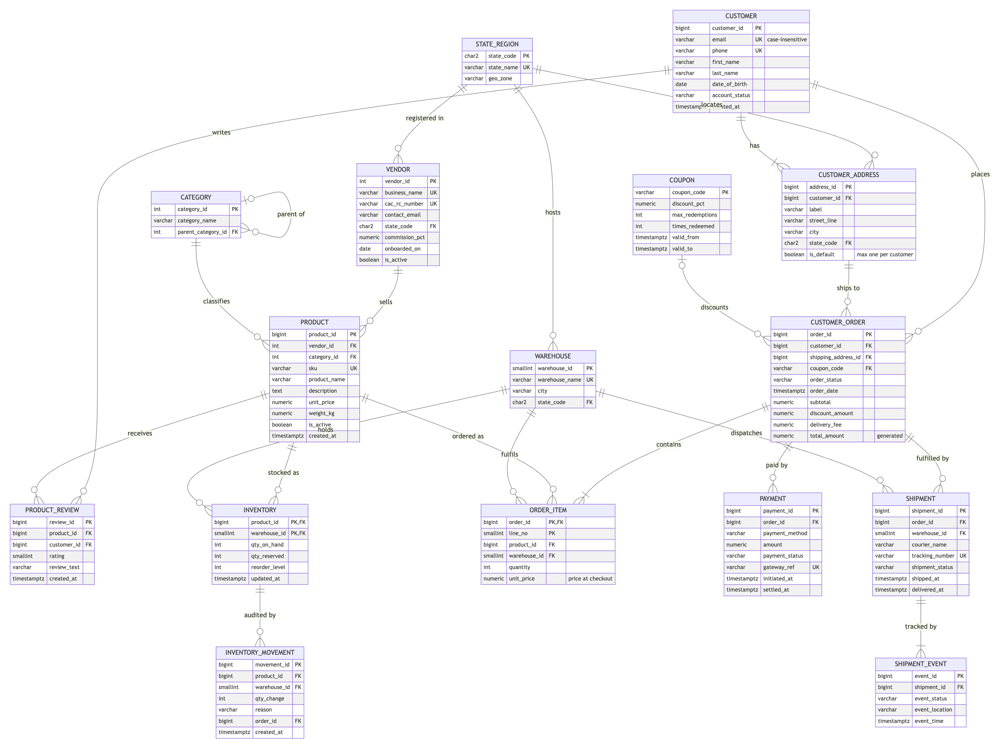
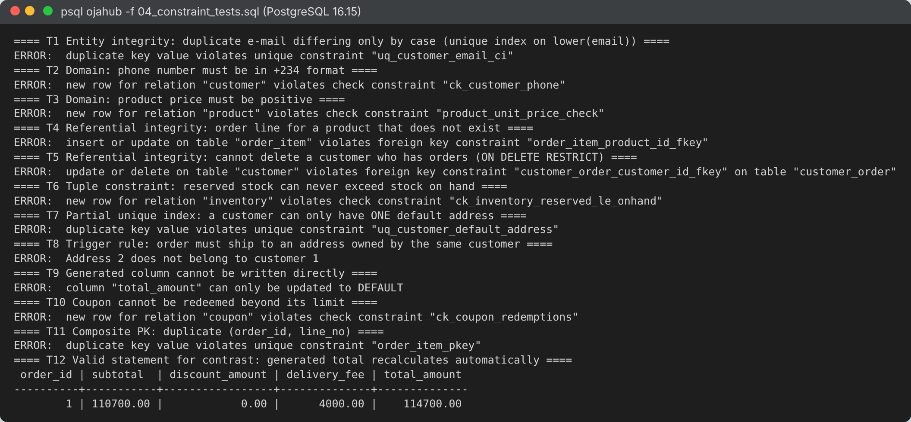

# Portfolio 1 – Database Design and Modelling

**Student:** Odunlade Oluwaseun (301931438) · **Case study:** SeunBaba Commerce Ltd · **DBMS:** PostgreSQL 16.16

## At a glance: evidence for the marker

| Expected evidence (assessment brief) | Where to find it |
|---|---|
| Chosen case study description | [§1 Case study statement](#1-case-study-statement) |
| ER diagram | [§2](#2-conceptual-model-er-diagram): [`diagrams/seunbaba_erd.png`](diagrams/seunbaba_erd.png) (source [`seunbaba_erd.mmd`](diagrams/seunbaba_erd.mmd)) |
| Relational schema | [§3](#3-relational-schema-logical-model) (logical) and [`sql/01_schema.sql`](sql/01_schema.sql) (physical DDL) |
| Keys | [§4 Keys](#4-keys): surrogate, natural, composite, alternate, composite FK, recursive FK |
| Constraints | [§5](#5-constraints-business-rules-enforced-in-the-database), proven by [`sql/04_constraint_tests.sql`](sql/04_constraint_tests.sql) → [`evidence/04_constraint_tests_output.txt`](evidence/04_constraint_tests_output.txt) |
| Normalisation explanation | [§6 Normalisation](#6-normalisation): UNF → 1NF → 2NF → 3NF → BCNF, with the functional dependencies listed |

**How it was implemented.** Hand-written PostgreSQL DDL (16 tables). Reference data and a deterministic synthetic data generator (`setseed`) give 300,000 orders.
**How it was tested.** 11 statements that *must* fail (each violates one business rule), all rejected by the DBMS, plus one valid statement for contrast. Row counts and table sizes are recorded in [`evidence/05_schema_overview.txt`](evidence/05_schema_overview.txt).
**Advanced concepts applied.** BCNF analysis, controlled denormalisation, generated stored column, partial unique index, case-insensitive expression index, trigger for a cross-row rule, ON DELETE RESTRICT vs CASCADE chosen per relationship.

## 1. Case study statement

| Item | Description |
|---|---|
| **Organisation (simulated)** | **SeunBaba Commerce Ltd**, a multi-vendor online marketplace based in Ikeja, Lagos. Its name comes from the Yoruba word *ọjà* (market). Independent Nigerian vendors list products, and SeunBaba handles checkout, payment collection, warehousing and last-mile delivery from four fulfilment hubs: Lagos, Abuja, Port Harcourt and Kano. |
| **Nature of business** | B2C e-commerce in Naira. Customers pay by card, bank transfer, USSD, wallet or pay-on-delivery. Demand is concentrated in Lagos, and there are seasonal peaks around "Detty December", Black Friday and Sallah. |
| **Database users** | Customers (web/mobile app), vendors (seller portal), warehouse staff (pick, pack and stock), customer-service agents, the finance team (payment reconciliation) and management (sales dashboards). |
| **Major data stored** | Customers and delivery addresses, vendors, a two-level product category tree, products, stock per warehouse, coupons, orders and order lines, payment attempts, shipments, courier tracking events, product reviews and a stock-movement audit trail. |
| **Key operations** | Register a customer; list a product; search the catalogue; **place an order** (reserve stock, apply a coupon, take payment); cancel or refund; dispatch and track a shipment; review a product; produce a low-stock report; analyse sales by state and month. |

## 2. Conceptual model (ER diagram)



The diagram source is in [`diagrams/seunbaba_erd.mmd`](diagrams/seunbaba_erd.mmd) (Mermaid, crow's-foot notation). It is rendered to PNG by [`../scripts/render_evidence.js`](../scripts/render_evidence.js).

Key modelling decisions:

* **ORDER_ITEM is an associative entity** that resolves the M:N relationship between CUSTOMER_ORDER and PRODUCT. It carries its own attributes: quantity, the price at checkout, and the warehouse that fulfils the line.
* **INVENTORY is a weak, associative entity** between PRODUCT and WAREHOUSE. It has no surrogate key: the pair (product_id, warehouse_id) is the natural primary key.
* **CATEGORY is recursive** (unary 1:N), so the catalogue can grow deeper than two levels without a schema change.
* **PAYMENT is 1:N with CUSTOMER_ORDER, not 1:1**, because a customer's first card attempt often fails and is retried. The schema has to keep every attempt for reconciliation. About 4% of seeded orders have a failed attempt.
* **SHIPMENT_EVENT** keeps the full courier history as an append-only log, rather than overwriting a single status column.

## 3. Relational schema (logical model)

The primary key is listed first in each relation (composite in INVENTORY and ORDER_ITEM); `*` marks a foreign key.

```
STATE_REGION(state_code, state_name, geo_zone)
CUSTOMER(customer_id, email, phone, first_name, last_name, date_of_birth, account_status, created_at)
CUSTOMER_ADDRESS(address_id, customer_id*, label, street_line, city, state_code*, is_default)
VENDOR(vendor_id, business_name, cac_rc_number, contact_email, state_code*, commission_pct, onboarded_on, is_active)
CATEGORY(category_id, category_name, parent_category_id*)
PRODUCT(product_id, vendor_id*, category_id*, sku, product_name, description, unit_price, weight_kg, is_active, created_at)
WAREHOUSE(warehouse_id, warehouse_name, city, state_code*)
INVENTORY(product_id*, warehouse_id*, qty_on_hand, qty_reserved, reorder_level, updated_at)
INVENTORY_MOVEMENT(movement_id, (product_id, warehouse_id)*, qty_change, reason, order_id*, created_at)
COUPON(coupon_code, discount_pct, max_redemptions, times_redeemed, valid_from, valid_to)
CUSTOMER_ORDER(order_id, customer_id*, shipping_address_id*, coupon_code*, order_status, order_date,
               subtotal, discount_amount, delivery_fee, total_amount[generated])
ORDER_ITEM(order_id*, line_no, product_id*, warehouse_id*, quantity, unit_price)
PAYMENT(payment_id, order_id*, payment_method, amount, payment_status, gateway_ref, initiated_at, settled_at)
SHIPMENT(shipment_id, order_id*, warehouse_id*, courier_name, tracking_number, shipment_status, shipped_at, delivered_at)
SHIPMENT_EVENT(event_id, shipment_id*, event_status, event_location, event_time)
PRODUCT_REVIEW(review_id, product_id*, customer_id*, rating, review_text, created_at)
```

The physical implementation is in [`sql/01_schema.sql`](sql/01_schema.sql).

## 4. Keys

| Key type | Where used | Why |
|---|---|---|
| **Surrogate PK** (`GENERATED ALWAYS AS IDENTITY`) | customer, product, customer_order, payment … | Natural identifiers such as email, phone and SKU can change. The surrogate stays stable for foreign keys, and `ALWAYS` stops applications from inserting their own ids. |
| **Natural PK** | state_region.state_code, coupon.coupon_code | These codes are short, stable and already unique in the business. |
| **Composite PK** | inventory(product_id, warehouse_id), order_item(order_id, line_no) | The identity of the row really is the combination of the two columns. |
| **Alternate / candidate keys** (`UNIQUE`) | customer.phone, lower(customer.email), product.sku, vendor.cac_rc_number, payment.gateway_ref, shipment.tracking_number | Each one prevents a real-world duplicate. `gateway_ref` also acts as an **idempotency key**, so a retried payment-gateway webhook cannot create a second payment. |
| **Composite FK** | inventory_movement(product_id, warehouse_id) → inventory | Every audit row must refer to an existing stock record. |
| **Recursive FK** | category.parent_category_id → category | Category hierarchy. |

## 5. Constraints (business rules enforced in the database)

| Rule | Mechanism |
|---|---|
| Email unique regardless of letter case | Unique **expression index** on `lower(email)` |
| Phone must be a Nigerian E.164 number (+234 followed by 10 digits) | `CHECK (phone ~ '^\+234[0-9]{10}$')` |
| Price > 0; quantity 1–100; rating 1–5; commission 0–40% | Column `CHECK`s |
| Reserved stock ≤ stock on hand, and both ≥ 0 | Table `CHECK` on inventory, so overselling is impossible at the storage level (used again in Portfolio 3) |
| Only one default address per customer | **Partial unique index** `… (customer_id) WHERE is_default` |
| An order must ship to one of the ordering customer's own addresses | `BEFORE INSERT/UPDATE` **trigger** (a cross-row rule a plain FK cannot express) |
| `total_amount = subtotal − discount + delivery_fee` | **Generated stored column**, which cannot drift and cannot be written directly |
| Coupon redemptions ≤ limit; valid_to > valid_from | Table `CHECK`s |
| Customers with orders cannot be deleted; deleting an order deletes its lines | `ON DELETE RESTRICT` / `ON DELETE CASCADE` chosen per relationship |
| Status columns accept only known values | `CHECK (… IN (…))` |

**Evidence.** [`sql/04_constraint_tests.sql`](sql/04_constraint_tests.sql) attempts 11 invalid operations, and every one is rejected by the DBMS. See [`evidence/04_constraint_tests_output.txt`](evidence/04_constraint_tests_output.txt) and the screenshot below.



## 6. Normalisation

**Starting point: the un-normalised order form.** Before the design, SeunBaba's (fictional) pilot ran on a spreadsheet with one row per order:

```
ORDER_FORM(order_no, order_date, cust_email, cust_name, cust_phone, delivery_address, city, state, geo_zone,
           { sku, product_name, vendor_name, category, qty, price }, payment_ref, payment_method, courier, tracking_no)
```

The braces mark a **repeating group**: one order holds many products.

**Functional dependencies identified**

```
order_no            → order_date, cust_email, delivery_address, payment_ref, courier, tracking_no
cust_email          → cust_name, cust_phone
city                → state ;  state → geo_zone
sku                 → product_name, vendor_name, category, current_price
vendor_name         → vendor contact data
(order_no, sku)     → qty, price_charged
payment_ref         → payment_method, amount, status
tracking_no         → courier, shipment_status
```

**1NF.** Remove the repeating group. Each product on an order becomes its own row, with key (order_no, sku), and every cell holds one atomic value. The free-text address is split into street, city and state.

**2NF.** Remove partial dependencies on the composite key. `product_name`, `vendor_name` and `category` depend on `sku` alone, so they move to PRODUCT. `order_date` and the customer details depend on `order_no` alone, so they move to ORDER. Only `qty` and `price_charged` depend on the whole key (order_no, sku), and these become ORDER_ITEM.

**3NF.** Remove transitive dependencies:
* order_no → cust_email → cust_name/phone gives a separate **CUSTOMER** table, referenced by FK.
* city → state → geo_zone gives **STATE_REGION**. Addresses store only `state_code`, so a zone name cannot be misspelled across 65,000 address rows.
* sku → vendor_name → vendor data gives **VENDOR**, and sku → category gives **CATEGORY**.
* Payment and tracking attributes depend on payment_ref and tracking_no, not on the order, which gives **PAYMENT** and **SHIPMENT**. This also allows 1:N retries.

**BCNF check.** In every final table, every determinant is a candidate key. For example, in `customer` both `customer_id` and `lower(email)` determine all other attributes, and both are declared keys. In `inventory`, the only determinant is (product_id, warehouse_id). No non-key attribute determines another attribute, so the schema is in **BCNF**.

**Deliberate, controlled denormalisation (and why it does not break integrity)**

| Attribute | Looks redundant because… | Why it is kept |
|---|---|---|
| `order_item.unit_price` | product already has unit_price | It is a **different fact**: the price *at checkout*. Catalogue prices change, but invoices must not. It is not functionally dependent on product_id. |
| `customer_order.subtotal` | It equals Σ(qty × price) over order_item | Read on every order-list page, so storing it avoids aggregating 640k lines. It is written only inside the `place_order` transaction (Portfolio 3), so the copies cannot diverge. |
| `customer_order.total_amount` | Derived from three columns | It is a **generated column**, so the DBMS recomputes it and it cannot become inconsistent. |
| `inventory.qty_reserved` | Could be derived from open orders | Needed for concurrency control: a row lock on one inventory row is far cheaper than aggregating open orders inside every checkout. |

## 7. How to build and test

```bash
createdb seunbaba
psql -d seunbaba -v ON_ERROR_STOP=1 -f sql/01_schema.sql
psql -d seunbaba -v ON_ERROR_STOP=1 -f sql/02_reference_data.sql
psql -d seunbaba -v ON_ERROR_STOP=1 -f sql/03_seed_data.sql      # about 35 s on an Apple M5 Pro
psql -d seunbaba -e -f sql/04_constraint_tests.sql
```

The seed is deterministic (`setseed(0.8103)`) and fully synthetic, with no real personal data. Volumes: 50,000 customers, 8,000 products, 300,000 orders, 642,738 order lines, 1.12 million tracking events. Table sizes are in [`evidence/05_schema_overview.txt`](evidence/05_schema_overview.txt).

**Problem met during the build.** The first seed run stocked every product in all four warehouses (32,000 inventory rows instead of about 17,500). The `EXPLAIN` output showed why: the planner had pushed `random() < 0.40` down into the scan of the small `warehouse` table and materialised it, so `random()` ran 4 times instead of once per (product, warehouse) pair. Correlating the expression with the outer row (`random() + p.product_id*0`) forced per-row evaluation. This was a practical reminder that a volatile function inside a join behaves differently from what the SQL text suggests.

**The same problem, found later.** While building the MongoDB catalogue (Portfolio 4), a text search for "air fryer" returned nothing, although air fryers are in the specification. Every category turned out to contain only **one** brand and item, for example all 364 audio products were "JBL Soundbar …". The `LATERAL (SELECT … random() …)` sub-selects that pick the brand referenced only the category row, so they were evaluated once per category instead of once per product. Adding `+ g * 0` correlates them with the generated row. I then regenerated the database and **all evidence in Portfolios 1–4** with [`../scripts/run_all.sh`](../scripts/run_all.sh). The catalogue now has 2,386 distinct product names.

**Time zone.** The database default time zone is set to `Africa/Lagos` in `01_schema.sql`. Without it, `date_trunc('month', order_date)` runs in UTC, and an order placed at 00:30 WAT on the 1st of a month is reported in the previous month. This was found by the SQL-vs-MongoDB cross-check in Portfolio 4.
