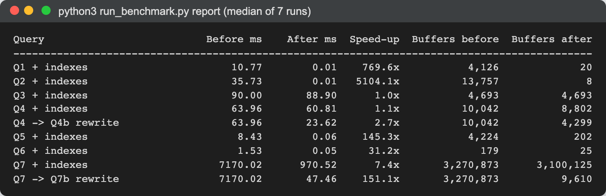
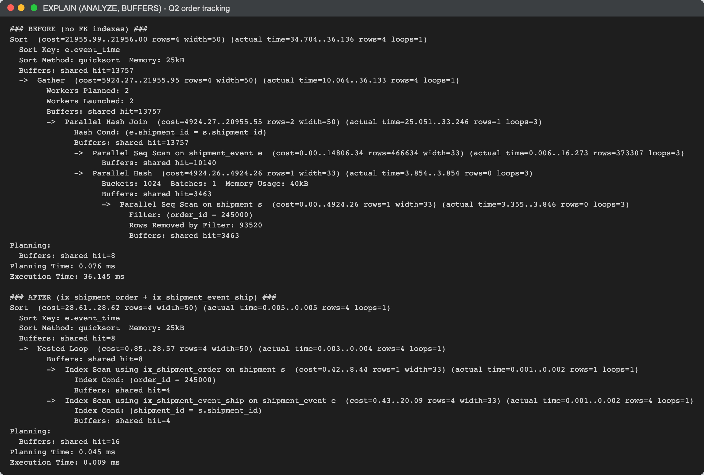
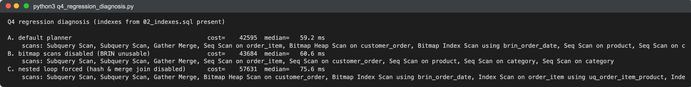

# Portfolio 2 – Query Processing and Optimisation

**Case study:** SeunBaba Commerce Ltd (same database as Portfolio 1: 300,000 orders, about 642,000 order lines, 1.12 million tracking events)
**Environment:** PostgreSQL 16.16 on an Apple M5 Pro (18 cores, macOS), `shared_buffers = 512MB`, default `work_mem = 4MB`, `max_parallel_workers_per_gather = 2`. All timings are warm-cache medians of 7 runs.

## At a glance: evidence for the marker

| Expected evidence (assessment brief) | Where to find it |
|---|---|
| SQL queries | [`sql/Odunlade_Oluwaseun_301931438_01_business_queries.sql`](sql/Odunlade_Oluwaseun_301931438_01_business_queries.sql) (Q1–Q7), [`sql/Odunlade_Oluwaseun_301931438_03_query_rewrites.sql`](sql/Odunlade_Oluwaseun_301931438_03_query_rewrites.sql) (Q7b), [`sql/Odunlade_Oluwaseun_301931438_04_materialized_view.sql`](sql/Odunlade_Oluwaseun_301931438_04_materialized_view.sql) (Q4b) |
| Query results | `evidence/before/Odunlade_Oluwaseun_301931438_Qn_result.txt` and `evidence/after/…_Qn_result.txt` |
| Execution plans | `evidence/before/Odunlade_Oluwaseun_301931438_Qn_plan.txt` and `evidence/after/…_Qn_plan.txt` (`EXPLAIN (ANALYZE, BUFFERS)`), screenshot [`Odunlade_Oluwaseun_301931438_Q2_plan_before_after.png`](evidence/Odunlade_Oluwaseun_301931438_Q2_plan_before_after.png) |
| Indexing / optimisation evidence | [`sql/Odunlade_Oluwaseun_301931438_02_indexes.sql`](sql/Odunlade_Oluwaseun_301931438_02_indexes.sql) → [`evidence/Odunlade_Oluwaseun_301931438_02_indexes_output.txt`](evidence/Odunlade_Oluwaseun_301931438_02_indexes_output.txt) (sizes); [§2 Results](#2-results); [`evidence/Odunlade_Oluwaseun_301931438_benchmark_summary.md`](evidence/Odunlade_Oluwaseun_301931438_benchmark_summary.md) |
| Brief performance analysis | [§3 Analysis of the execution plans](#3-analysis-of-the-execution-plans), [§4 Cost of the indexes](#4-cost-of-the-indexes-write-side-trade-off), [§5 Lessons](#5-lessons-learned) |

**How it was implemented.** Seven queries taken from real SeunBaba screens and reports. Each is optimised with the technique that suits its plan: B-tree, covering, partial, BRIN or trigram GIN index; a set-based rewrite; or a materialised view.
**How it was tested.** [`Odunlade_Oluwaseun_301931438_run_benchmark.py`](Odunlade_Oluwaseun_301931438_run_benchmark.py) uses 1 warm-up run plus 7 timed runs and reports the median, so a single noisy run cannot decide the result. Rewrites are proven equivalent by `diff` of their result files. The Q4 plan choice was tested with a controlled planner experiment ([`Odunlade_Oluwaseun_301931438_q4_regression_diagnosis.py`](Odunlade_Oluwaseun_301931438_q4_regression_diagnosis.py)).
**Advanced concepts applied.** Cost-based optimiser vs actual runtime, selectivity, parallel query, physical correlation and BRIN, index-only scans and the visibility map, early aggregation, materialised views with `REFRESH CONCURRENTLY`.

## 1. What is in this folder

| File | Purpose |
|---|---|
| [`sql/Odunlade_Oluwaseun_301931438_01_business_queries.sql`](sql/Odunlade_Oluwaseun_301931438_01_business_queries.sql) | Seven real SeunBaba workloads (Q1–Q7): point lookups, a join path, reporting with window functions, a search box and a vendor statement |
| [`sql/Odunlade_Oluwaseun_301931438_02_indexes.sql`](sql/Odunlade_Oluwaseun_301931438_02_indexes.sql) | Physical optimisation: B-tree (composite, covering, DESC), partial, BRIN and trigram GIN indexes, each tied to a query |
| [`sql/Odunlade_Oluwaseun_301931438_03_query_rewrites.sql`](sql/Odunlade_Oluwaseun_301931438_03_query_rewrites.sql) | Logical optimisation: Q7 rewritten from correlated sub-queries to set-based aggregation (Q7b) |
| [`sql/Odunlade_Oluwaseun_301931438_04_materialized_view.sql`](sql/Odunlade_Oluwaseun_301931438_04_materialized_view.sql) | Materialised daily sales summary plus early aggregation (Q4b) |
| [`Odunlade_Oluwaseun_301931438_run_benchmark.py`](Odunlade_Oluwaseun_301931438_run_benchmark.py) | Harness that captures results, `EXPLAIN (ANALYZE, BUFFERS)` plans and median timings |
| `evidence/before/`, `evidence/after/` | One `Odunlade_Oluwaseun_301931438_Qn_plan.txt` and one `…_Qn_result.txt` per query and phase |
| [`evidence/Odunlade_Oluwaseun_301931438_benchmark_summary.md`](evidence/Odunlade_Oluwaseun_301931438_benchmark_summary.md) | Generated comparison table |
| [`evidence/Odunlade_Oluwaseun_301931438_Q4_regression_diagnosis.txt`](evidence/Odunlade_Oluwaseun_301931438_Q4_regression_diagnosis.txt) | Controlled experiment explaining a slowdown caused by an index |

Reproduce:

```bash
python3 Odunlade_Oluwaseun_301931438_run_benchmark.py before
psql -d seunbaba -f sql/Odunlade_Oluwaseun_301931438_02_indexes.sql
python3 Odunlade_Oluwaseun_301931438_run_benchmark.py after       # also runs Q4b and Q7b
python3 Odunlade_Oluwaseun_301931438_run_benchmark.py report
```

## 2. Results



| Query | Business purpose | Before | After | Change | Technique |
|---|---|---:|---:|---:|---|
| Q1 | Customer's last 10 orders (login by email) | 10.77 ms | 0.014 ms | **~770×** | Composite covering index `(customer_id, order_date DESC) INCLUDE (...)` |
| Q2 | Order tracking page | 35.73 ms | 0.007 ms | **~5,100×** | Index the two foreign keys on the join path |
| Q3 | Monthly revenue by geo-zone, month-on-month % | 90.00 ms | 88.90 ms | ~none | Index *correctly not useful* (see analysis) |
| Q4 | Top 5 products per category, last 90 days | 63.96 ms | 60.81 ms | ~none (1.05×) | BRIN index used, but the scan of `order_item` dominates (see analysis) |
| Q4b | Same question via materialised view + early aggregation | 63.96 ms | 23.62 ms | **2.7×** | Materialised view, aggregate-before-join |
| Q5 | Paid orders not yet dispatched after 24 h | 8.43 ms | 0.058 ms | **~145×** | Partial index `WHERE order_status = 'PAID'` (40 kB) |
| Q6 | Search box `ILIKE '%air fryer%'` | 1.53 ms | 0.049 ms | **~31×** | Trigram GIN index (`pg_trgm`) |
| Q7 | Vendor statement (correlated sub-queries) | 7,170 ms | 971 ms | 7.4× | FK indexes only |
| Q7b | Same statement, rewritten set-based | 7,170 ms | 47.46 ms | **~151×** | Query rewrite, aggregate once, then join |

Full figures, including buffer counts and estimated costs, are in [`evidence/Odunlade_Oluwaseun_301931438_benchmark_summary.md`](evidence/Odunlade_Oluwaseun_301931438_benchmark_summary.md). I checked that each rewrite returns the same rows: `diff` of `Q4_result` vs `Q4b_result` and of `Q7_result` vs `Q7b_result` shows no differences apart from the first line, which names the query.

## 3. Analysis of the execution plans

**Q2: index nested loop replaces two full scans.** Before indexing, PostgreSQL had no access path to `shipment` by `order_id`. It launched 2 parallel workers, scanned all 280,562 shipments (*Rows Removed by Filter: 93,520* per worker) and hashed them, then scanned all 1.12 million `shipment_event` rows to find 4 of them, touching 13,757 buffers. PostgreSQL does **not** create indexes on foreign-key columns automatically, which many designers assume it does. With the two FK indexes, the optimiser switched to an **index nested-loop join**: one probe into `ix_shipment_order`, then one range scan on `ix_shipment_event_ship (shipment_id, event_time)`. That is 8 buffers in total, and the composite index already returns events in `event_time` order, so the final sort costs nothing.



**Q1: composite index matches the predicate and the ORDER BY.** The email lookup was already fast through the unique expression index `lower(email)` from Portfolio 1, which only works because the query also writes `lower(c.email)`. The cost was in finding that customer's orders: a parallel seq scan of all 300,000 orders. The `(customer_id, order_date DESC)` index turns this into a read of 13 index entries (*Bitmap Index Scan on ix_order_customer_date … rows=13*), and buffers fall from 4,126 to 20. With so few rows the planner chose a *bitmap* scan. The `INCLUDE` columns would allow an index-only scan for heavy customers with hundreds of orders, once `VACUUM` has set the visibility map.

**Q5 and Q6: specialised index types.** Only 813 of 300,000 orders are in status PAID. A **partial index** stores just those rows (40 kB, compared with 6,600 kB measured for a full B-tree on `order_date`), and it costs nothing when the other 99.7% of orders are written. For Q6, a leading-wildcard `ILIKE` cannot use a B-tree at all, because there is no prefix to seek on. Before indexing, PostgreSQL read all 8,000 products and discarded 7,932. The **trigram GIN** index breaks names into 3-character grams, so the planner does a *Bitmap Index Scan on gin_product_name_trgm* (70 candidates) followed by a *Recheck*.

**Q3: why an index did not help, and why that is the right outcome.** Q3 reads January–October 2026 orders, which is **37.0% of the table** (110,986 of 300,000). At that selectivity, random index access costs more than a sequential read, so a B-tree would not be chosen. In this run the planner did not use the BRIN index either: both plans are a plain `Seq Scan on customer_order` (98,304 qualifying rows). `pg_stats.correlation` for `order_date` is only **0.29**, because the seed script's bulk UPDATEs and the later Portfolio 3 demos moved row versions around the heap, so most block ranges overlap the date range and BRIN could skip very little. The real cost of Q3 is the hash joins over about 100,000 qualifying orders, not the access path. To make Q3 faster, the options are a summary table (as done for Q4) or `CLUSTER` on `order_date` to restore physical ordering. A further index would not help.

**Q4: an index can change the plan, for better or worse.** In the first benchmark run (a 4-vCPU Linux container, `work_mem = 16MB`; evidence in git history at commit `472931c`), adding the indexes made Q4 **1.65× slower** (138.6 → 228.5 ms) even though its estimated cost fell. The BRIN index made the `customer_order` side look cheap, so the planner switched from a parallel hash join to a **serial** BRIN bitmap plan that still scanned all 642,000 `order_item` rows on one core. Forcing the parallel plan (`enable_bitmapscan = off`) took 121 ms against 232 ms for the default.

In the final run on the M5 Pro, the planner kept the **parallel** plan after indexing: `Gather Merge → Parallel Hash Join`, with the BRIN index used *inside* the parallel scan (`Parallel Bitmap Heap Scan … Bitmap Index Scan on brin_order_date`, `Heap Blocks: lossy=1413`). Q4 was therefore not slower, but it was not meaningfully faster either (63.96 → 60.81 ms). The controlled experiment ([`Odunlade_Oluwaseun_301931438_q4_regression_diagnosis.py`](Odunlade_Oluwaseun_301931438_q4_regression_diagnosis.py), output in [`evidence/Odunlade_Oluwaseun_301931438_Q4_regression_diagnosis.txt`](evidence/Odunlade_Oluwaseun_301931438_Q4_regression_diagnosis.txt)) shows why:

| Planner setting | Estimated cost | Median time | Plan shape |
|---|---:|---:|---|
| A. default | **42,595** (cheapest) | **59.2 ms** | parallel, BRIN bitmap scan on `customer_order` |
| B. `enable_bitmapscan = off` | 43,684 | 60.6 ms | parallel seq scans (`Gather Merge`) |
| C. hash and merge joins disabled | 57,631 | 75.6 ms | parallel index nested loops |

This time the cheapest estimated plan was also the fastest, and plans A and B are within 2% of each other. Whichever way the `customer_order` rows are found, every run must scan all of `order_item`, which has no date column. Together, the two runs show that the cost model estimates I/O and CPU work, not wall-clock time: the same index produced a worse plan on one machine and a neutral one on another.

The fix does not depend on planner settings: since the `order_item` scan cannot be avoided at query time, the work is moved to **write/refresh time**. The materialised view `mv_daily_product_sales` (545,302 rows, 48 MB) pre-joins and pre-aggregates sales per product per Lagos calendar day and is refreshed nightly with `REFRESH MATERIALIZED VIEW CONCURRENTLY`, which needs its unique index. Q4b also **aggregates by product_id before joining** to `product` and `category`, so the joins process about 7,950 rows instead of about 62,000. The result is 23.62 ms and 4,299 buffers, 2.7× faster than the original query. The trade-off is that the report is up to one day stale, which is acceptable for a merchandising report but not for stock levels.



**Q7: logical optimisation outperforms physical optimisation.** The naive vendor statement runs a correlated sub-query for each of the 144 active vendors. The plan shows `Aggregate … loops=144` over a nested loop that is itself repeated 144 times. The baseline touched **3.27 million buffers** (about 25 GB of page visits at 8 kB) in 7.2 s. Indexes alone gave only 7.4×, because the same work is still repeated 144 times. Rewriting the query so that sales and ratings are each aggregated **once** with `GROUP BY vendor_id` and then LEFT JOINed to `vendor` reduced the work to 9,610 buffers and 47 ms, about **151× faster**, with identical results.

**Time-zone correctness (found later, in Portfolio 4).** When I cross-checked Q3 against MongoDB, two orders landed in different months. `date_trunc('month', order_date)` uses the *session* time zone, which was UTC, so an order placed at 00:30 WAT on 1 October was counted as a September sale. The schema now sets `ALTER DATABASE … SET timezone = 'Africa/Lagos'`, and all results above were regenerated after that fix.

## 4. Cost of the indexes (write-side trade-off)

| Index | Size | Notes |
|---|---:|---|
| ix_shipment_event_ship | 34 MB | Largest, on the 1.1 M-row event log. It is worth it, because tracking is the most frequent customer query. |
| ix_order_customer_date | 16 MB | Covering columns enlarge it, but it serves every "My Orders" page |
| ix_shipment_order | 6.0 MB | |
| ix_order_item_product | 4.4 MB | Also prevents a full scan when a product is deleted (FK check) |
| gin_product_name_trgm | 520 kB | GIN is slow to update, but the product catalogue changes rarely |
| ix_order_awaiting_dispatch | 40 kB | Partial: maintained only for PAID rows |
| brin_order_date | 24 kB | 275× smaller than a B-tree on the same column (measured: 6,600 kB), but lossy at correlation 0.29 |

Every index slows `INSERT/UPDATE` on its table and uses buffer cache. For that reason I did **not** index low-selectivity columns such as `order_status` on their own, and I kept Q3 index-free.

## 5. Lessons learned

1. Measure, don't assume. Two of my seven indexing changes had no useful effect in the final run (Q3, Q4), one made Q4 slower in the first run, and only `EXPLAIN (ANALYZE, BUFFERS)` showed it.
2. Buffer counts are a more stable metric than milliseconds, because they do not vary with cache or CPU noise.
3. Rewriting the SQL (Q7) and changing where work happens (materialised view for Q4) gave bigger wins on reporting queries than indexing. Indexes gave the biggest wins on OLTP point queries (Q1, Q2, Q5, Q6).
