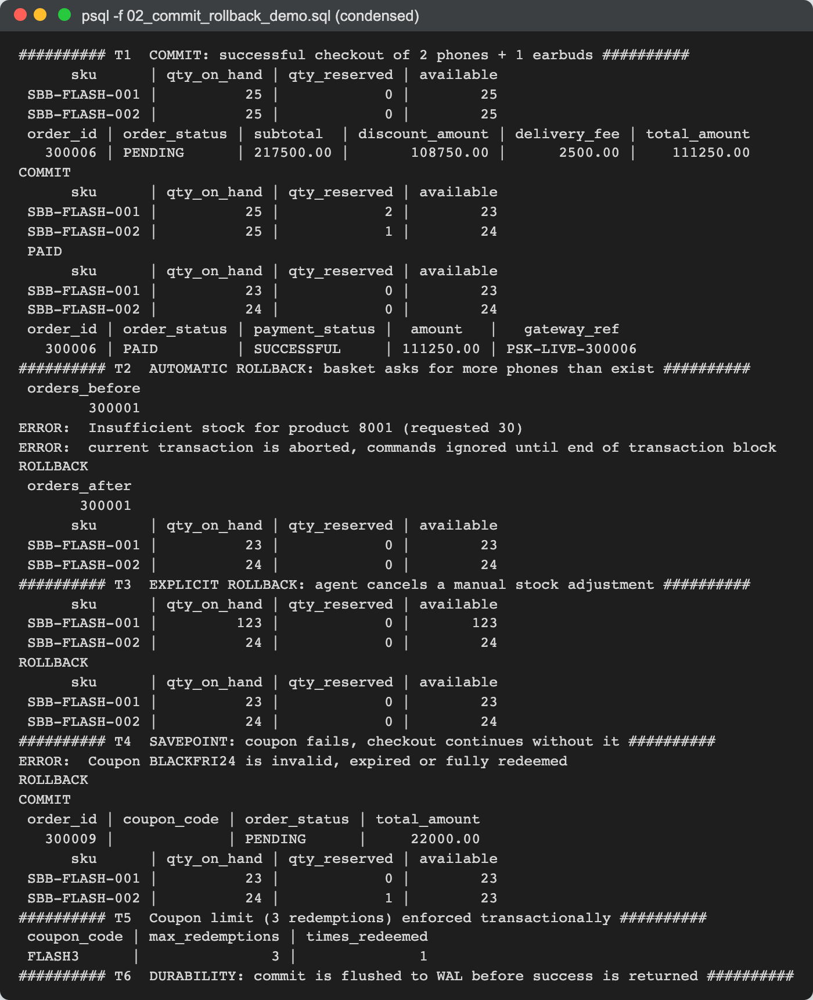
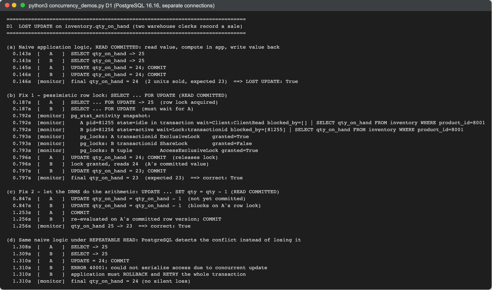
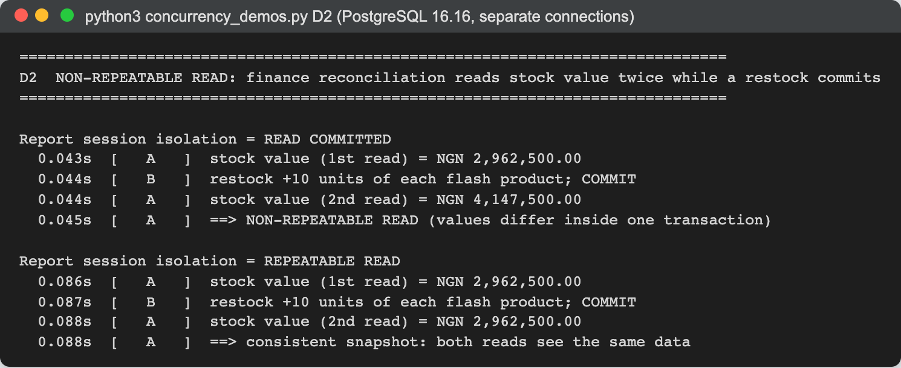
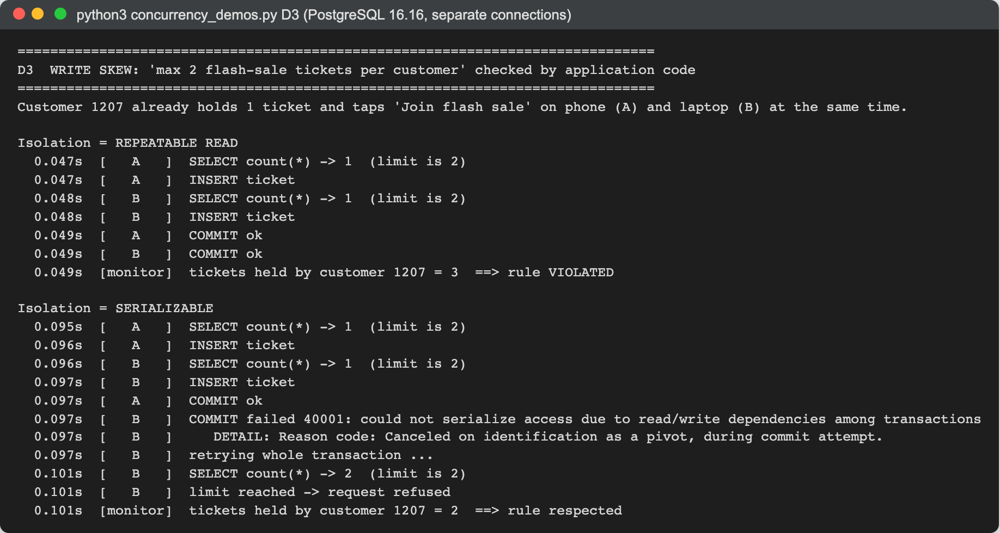
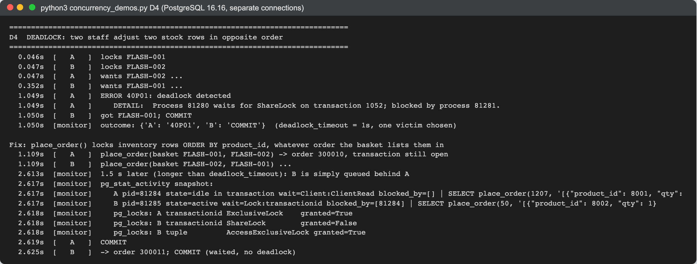
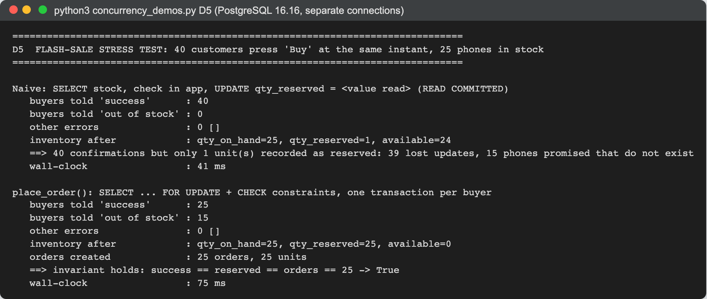

# Portfolio 3 – Transactions and Concurrency

**Case study:** SeunBaba Commerce Ltd, checkout and flash sales · **DBMS:** PostgreSQL 16.16 (MVCC, default isolation READ COMMITTED)

## At a glance: evidence for the marker

| Expected evidence (assessment brief) | Where to find it |
|---|---|
| Transaction showing **COMMIT** | T1 in [§3](#3-single-session-results-t1t6), [`sql/Odunlade_Oluwaseun_301931438_02_commit_rollback_demo.sql`](sql/Odunlade_Oluwaseun_301931438_02_commit_rollback_demo.sql) → [`evidence/Odunlade_Oluwaseun_301931438_02_commit_rollback_output.txt`](evidence/Odunlade_Oluwaseun_301931438_02_commit_rollback_output.txt) |
| Transaction showing **ROLLBACK** | T2 (automatic, on error), T3 (explicit), T4 (`ROLLBACK TO SAVEPOINT`) |
| **Isolation** | D2 (READ COMMITTED vs REPEATABLE READ), D3 (REPEATABLE READ vs SERIALIZABLE), D1(d), and the level choice in [§5](#5-choosing-an-isolation-level-for-seunbaba) |
| **Concurrency issue** | D1 lost update, D2 non-repeatable read, D3 write skew, D4 deadlock, D5 oversell under 40 concurrent buyers |
| **Control mechanism** | `SELECT … FOR UPDATE` in fixed lock order, atomic conditional `UPDATE`, SERIALIZABLE with retry, CHECK constraints, idempotent payment callback ([`sql/Odunlade_Oluwaseun_301931438_01_checkout_functions.sql`](sql/Odunlade_Oluwaseun_301931438_01_checkout_functions.sql)) |
| Screenshots / output evidence | `evidence/*.txt` (raw timelines) and `evidence/*.png` |

**How it was implemented.** The checkout is a PL/pgSQL function, so a single call is a single transaction. The concurrency demos ([`scripts/Odunlade_Oluwaseun_301931438_concurrency_demos.py`](scripts/Odunlade_Oluwaseun_301931438_concurrency_demos.py)) open **separate real connections** and interleave their statements in a fixed order, so every anomaly is reproducible on demand. A third "monitor" connection reads `pg_stat_activity` and `pg_locks` while a session is blocked.
**How it was tested.** Each demo prints the final database state and checks the invariant (for example `success == reserved == orders == 25`). Each anomaly is shown first *occurring*, then *prevented*.
**Advanced concepts applied.** MVCC snapshots, EvalPlanQual re-check under READ COMMITTED, first-updater-wins, Serializable Snapshot Isolation (rw-antidependency, pivot), deadlock detection, lock ordering, non-transactional sequences, two-phase stock reservation.

## 1. The problem in SeunBaba's terms

During a flash sale ("25 Infinix phones at ₦99,000, 12:00 noon"), hundreds of shoppers press **Buy** within the same second. Each checkout touches **six tables**: inventory, customer_order, order_item, inventory_movement, coupon and payment. The business needs:

* **Atomicity.** A checkout either creates the order, reserves the stock, redeems the coupon and opens the payment, or does none of these.
* **Consistency.** It never sells a phone that does not exist (`qty_reserved ≤ qty_on_hand`) and never exceeds a coupon's limit.
* **Isolation.** Two shoppers must not see or overwrite each other's half-finished work.
* **Durability.** Once the customer sees "Order confirmed", a server crash must not lose the order.

## 2. Implementation

| File | Content |
|---|---|
| [`sql/Odunlade_Oluwaseun_301931438_00_demo_setup.sql`](sql/Odunlade_Oluwaseun_301931438_00_demo_setup.sql) | Idempotent reset: two flash-sale products with exactly 25 units each, coupon `FLASH3` (3 redemptions), and the `flash_sale_ticket` table |
| [`sql/Odunlade_Oluwaseun_301931438_01_checkout_functions.sql`](sql/Odunlade_Oluwaseun_301931438_01_checkout_functions.sql) | **`place_order()`** and **`settle_payment()`**, PL/pgSQL functions that each run as one transaction |
| [`sql/Odunlade_Oluwaseun_301931438_02_commit_rollback_demo.sql`](sql/Odunlade_Oluwaseun_301931438_02_commit_rollback_demo.sql) | Single-session demos T1–T6: COMMIT, automatic ROLLBACK, explicit ROLLBACK, SAVEPOINT, durability settings |
| [`scripts/Odunlade_Oluwaseun_301931438_concurrency_demos.py`](scripts/Odunlade_Oluwaseun_301931438_concurrency_demos.py) | Multi-session demos D1–D5 using real, separate connections with controlled interleaving, a timestamped timeline and a lock monitor |
| `evidence/` | Captured output (`.txt`) and screenshots (`.png`) of every run |

The concurrency design of `place_order()`:

1. **Pessimistic locking in a fixed order.** `SELECT … FROM inventory WHERE product_id IN (basket) ORDER BY product_id, warehouse_id FOR UPDATE`. Every checkout locks stock rows in the same global order, so two checkouts can queue behind each other but cannot form a lock cycle (no deadlock, see D4).
2. **Check, then act, while holding the lock.** It picks a warehouse with `qty_on_hand − qty_reserved ≥ qty`, then `UPDATE … qty_reserved = qty_reserved + qty`. The table CHECK `qty_reserved ≤ qty_on_hand` from Portfolio 1 is a second safety net enforced by the storage engine.
3. **Coupon redemption as one conditional UPDATE.** `UPDATE coupon SET times_redeemed = times_redeemed + 1 WHERE … AND times_redeemed < max_redemptions`. Under READ COMMITTED, a second concurrent redeemer blocks on the row lock. PostgreSQL then **re-evaluates the WHERE clause on the newly committed row version** (the EvalPlanQual recheck), so the limit holds without a separate read.
4. **Two-phase stock handling.** `place_order` only *reserves* stock. `settle_payment(order, true)` converts the reservation into a deduction, and `settle_payment(order, false)` releases the stock and the coupon. `settle_payment` locks the order row first and ignores callbacks for orders that are no longer PENDING, so a payment-gateway webhook delivered twice is **idempotent**. `payment.gateway_ref` is UNIQUE for the same reason.

## 3. Single-session results (T1–T6)



| Test | What happened | ACID property shown |
|---|---|---|
| T1 COMMIT | 2 phones and 1 earbuds ordered with coupon FLASH3 (50%). Stock moved from *available* to *reserved* (25→23 available). After `settle_payment(true)`, on-hand fell to 23 and 24, the reservation returned to 0, and the order became PAID with a SUCCESSFUL payment. | Atomicity, Consistency |
| T2 automatic ROLLBACK | Basket of 1 earbuds and 30 phones. The earbuds line is processed first (ordered by product_id) and the phone line raises `Insufficient stock`. The transaction is now **aborted**: the next statement is refused, and the final `COMMIT` is turned into `ROLLBACK` by PostgreSQL. Order count and stock are unchanged, and the earbuds reservation was undone too. | Atomicity |
| T3 explicit ROLLBACK | A manual +100 adjustment is visible *inside* the transaction (123) and disappears after `ROLLBACK` (23). | Isolation, Atomicity |
| T4 SAVEPOINT | The first attempt uses an expired coupon and fails. `ROLLBACK TO SAVEPOINT` undoes only that attempt, and the second attempt without a coupon is committed. | Partial rollback |
| T5 | The coupon counter shows exactly 1 redemption: T2's rolled-back work did not touch it. | Consistency |
| T6 | `synchronous_commit = on` and `fsync = on`. COMMIT returns only after the commit record is flushed to the write-ahead log (WAL). | Durability |

**Observation.** The order IDs created were 300006 and then 300009. IDs 300007 and 300008 were consumed by the rolled-back attempts in T2 and T4. Identity and sequence values are **deliberately non-transactional**, so concurrent inserts never wait on each other. Invoice numbers that must be gap-free therefore need a separate, locked counter.

## 4. Concurrency results (D1–D5)

### D1: Lost update and three fixes


* **(a) Naive read-modify-write under READ COMMITTED.** Both clerks read 25 and both write 24. Two phones were sold, but stock only dropped by one. This is a **lost update**. READ COMMITTED does not prevent it, because each statement is individually correct.
* **(b) `SELECT … FOR UPDATE`.** B blocks. The monitor connection shows B `state=active wait=Lock:transactionid blocked_by=[A's pid]`, and `pg_locks` shows B's `ShareLock` on A's transaction ID with `granted=False`. When A commits, B reads 24 and writes 23, which is correct.
* **(c) Atomic `SET qty = qty − 1`.** B blocks behind A's row lock, then re-applies its update to A's committed row version. The result (25→23) is correct without any explicit lock.
* **(d) Same naive code under REPEATABLE READ.** PostgreSQL refuses B's write with **`40001 could not serialize access due to concurrent update`** (first updater wins). Nothing is lost, but the application must retry the transaction.

### D2: Non-repeatable read


A finance report reads the stock value twice while a restock commits in between. Under **READ COMMITTED** each *statement* gets a fresh snapshot, so the report sees ₦2,962,500 and then ₦4,147,500 inside one transaction. Under **REPEATABLE READ** the snapshot is taken at the first statement and kept for the whole transaction, so both reads return ₦2,962,500. With MVCC the report never blocks the restock and the restock never blocks the report: readers and writers do not lock each other.

### D3: Write skew, which only SERIALIZABLE prevents


The rule is "maximum 2 flash-sale tickets per customer", checked in application code with `count(*)` followed by `INSERT`. The customer already has 1 ticket and taps on phone and laptop at once. Each transaction reads 1 and inserts a *different* new row, so there is no row-level write conflict. Under **REPEATABLE READ** both commit and the customer ends up with **3 tickets**, which violates the rule. Under **SERIALIZABLE**, PostgreSQL's Serializable Snapshot Isolation (SSI) tracks the read/write dependencies (rw-antidependencies) through predicate locks. It cancels B at commit (`40001 … Canceled on identification as a pivot`), the retry sees 2 tickets, and the request is refused. This is the one anomaly where an extra lock on an existing row does not help, because the conflicting row does not exist yet (a phantom).

### D4: Deadlock and prevention by lock ordering


Session A locks FLASH-001 and then wants FLASH-002, while B locks FLASH-002 and then wants FLASH-001. After `deadlock_timeout` (1 s), PostgreSQL's deadlock detector finds the cycle and aborts one victim with **`40P01 deadlock detected`** (*Process … waits for ShareLock on transaction …; blocked by process …*). The other session then commits. Running the same conflict through `place_order()`, with the two baskets in **opposite order**, B simply **waits** for 1.5 s, longer than the deadlock timeout, and then succeeds. Because the function sorts lock acquisition by product_id, a cycle cannot occur.

### D5: Flash-sale stress test (40 buyers, 25 phones)


| | Naive application logic | `place_order()` |
|---|---:|---:|
| Buyers told "success" | **40** | **25** |
| Buyers told "out of stock" | 0 | 15 |
| `qty_reserved` afterwards | **1** | **25** |
| Orders / units created | – | 25 / 25 |
| Wall-clock for all 40 | 41 ms | 75 ms |

All 40 threads start at the same instant using a `threading.Barrier`. The naive version confirmed 40 purchases of a 25-unit item but recorded only 1 reservation: 39 updates were lost and 15 phones were promised that do not exist. With `place_order()`, exactly 25 buyers succeed and 15 receive a clean `SB003 Insufficient stock` error, and the invariant *confirmed = reserved = ordered = 25* holds. The cost of correctness is serialisation on one hot row, about 1.8× the wall-clock time. For larger sales, SeunBaba could shard the stock across several "bucket" rows or move the counter to Redis with an atomic `DECR`, which Portfolio 4 tests (Redis R5: 25 correct sales in about 15 ms).

## 5. Choosing an isolation level for SeunBaba

| Workload | Level | Reason |
|---|---|---|
| Checkout, payment settlement | READ COMMITTED + explicit `FOR UPDATE` and atomic conditional UPDATEs | Highest throughput. The invariants are protected by locks and CHECK constraints, and no retry loop is needed. |
| Rules that depend on *counting* rows (purchase limits, slot capacity) | SERIALIZABLE with a retry on SQLSTATE 40001 | Only SSI prevents write skew and phantoms (D3) |
| Month-end finance and stock reconciliation reports | REPEATABLE READ (read-only) | A consistent snapshot without blocking writers (D2) |

## 6. How to run

```bash
psql -d seunbaba -f sql/Odunlade_Oluwaseun_301931438_01_checkout_functions.sql
psql -d seunbaba -f sql/Odunlade_Oluwaseun_301931438_00_demo_setup.sql
psql -d seunbaba -e -f sql/Odunlade_Oluwaseun_301931438_02_commit_rollback_demo.sql
pip install psycopg2-binary
python3 scripts/Odunlade_Oluwaseun_301931438_concurrency_demos.py          # or: D1 D3 ...
```
