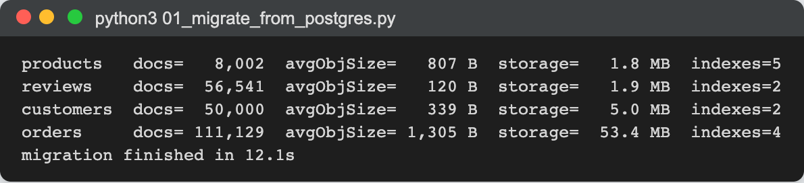
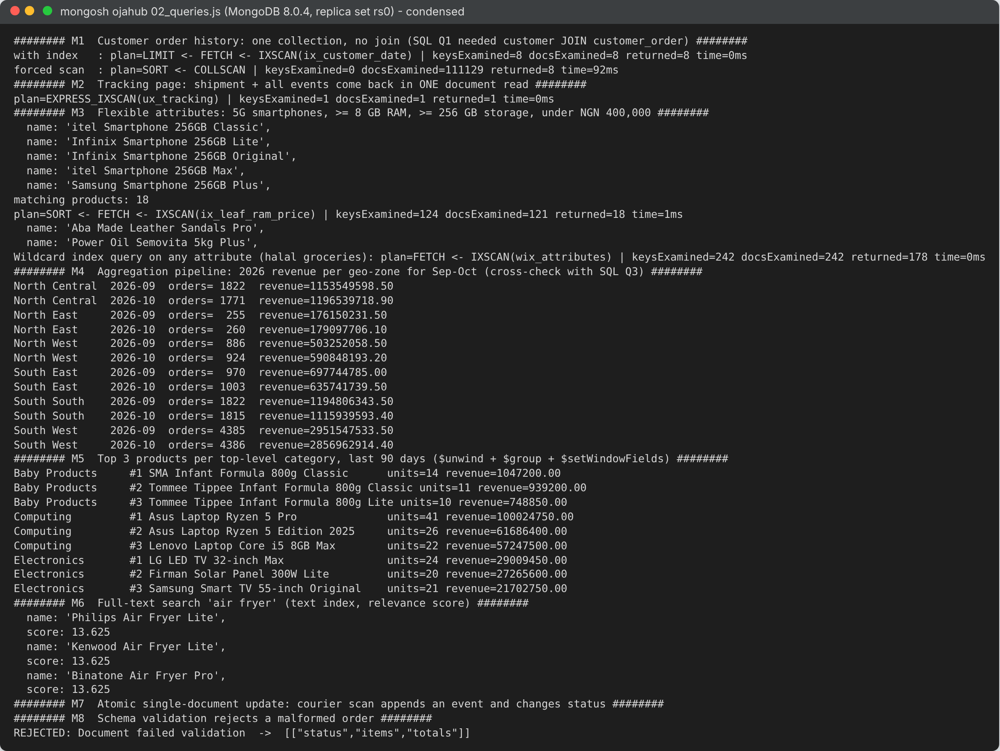
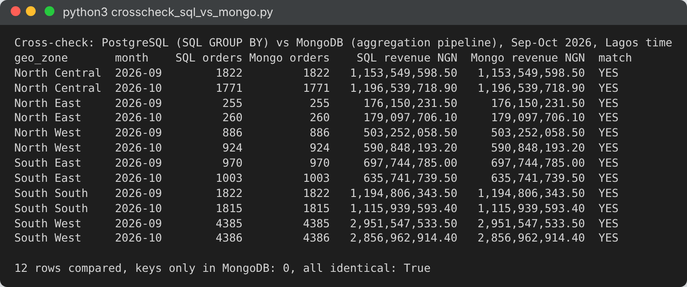
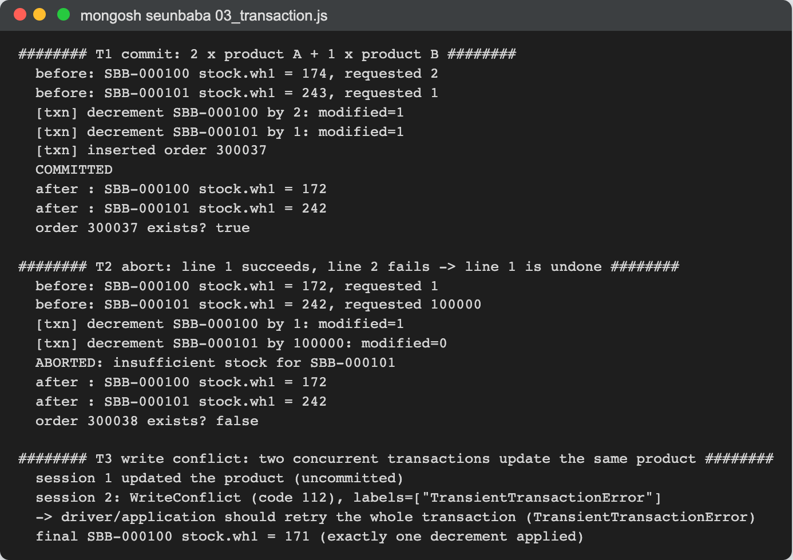
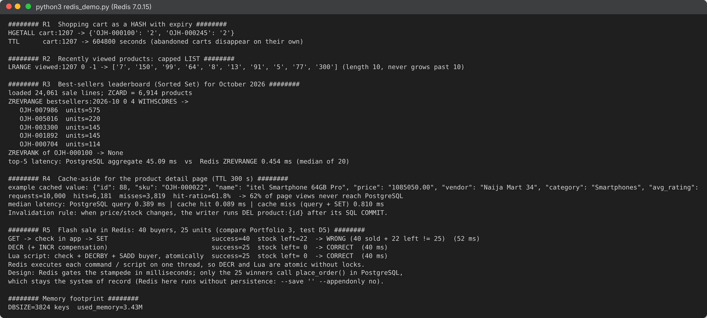

# Portfolio 4 – NoSQL and Advanced Data Models

**Case study:** SeunBaba Commerce Ltd (same data as Portfolios 1–3, migrated from PostgreSQL)
**Engines:** MongoDB 9.0.8 (document store, replica set `rs0`) · Redis 8.10.3 (key-value / data-structure store) · Apache Cassandra (wide-column, *design only*)

## At a glance: evidence for the marker

| Expected evidence (assessment brief) | Where to find it |
|---|---|
| NoSQL model based on the **same case study** | The same SeunBaba data, migrated by [`mongodb/01_migrate_from_postgres.py`](mongodb/01_migrate_from_postgres.py) |
| **Document** example | [§2](#2-document-model-mongodb): a real order document, embedding decisions, validator, indexes |
| **Key-value** example | [§3](#3-key-value--data-structure-model-redis): Redis HASH, LIST, ZSET, STRING+TTL, Lua ([`redis/redis_demo.py`](redis/redis_demo.py)) |
| **Column (wide-column)** example | [§4](#4-wide-column-model-cassandra-design-only): Cassandra query-first design ([`cassandra_design/shipment_tracking.cql`](cassandra_design/shipment_tracking.cql)), **design only** |
| **Graph** example | [§4](#4-wide-column-model-cassandra-design-only), graph discussion ("customers who bought X also bought Y") |
| Implementation evidence | `evidence/01`–`05` (`.txt` and `.png`): migration, queries with `explain()`, transaction, Redis, SQL-vs-MongoDB cross-check |
| Explanation of suitability | [§1](#1-why-nosql-at-all-for-seunbaba) (which workloads and why) and [§5](#5-comparison-and-polyglot-persistence-decision) (comparison and polyglot decision) |
| Configuration | [`config/redis.conf`](config/redis.conf) (persistence deliberately off); MongoDB replica set member settings in [`../portfolio-5-distributed-cloud/config/mongod-rs0.conf`](../portfolio-5-distributed-cloud/config/mongod-rs0.conf) |

**How it was implemented.** An ETL script reads PostgreSQL and writes MongoDB documents. Queries, an aggregation pipeline and a multi-document transaction run in `mongosh`. Redis structures are driven from Python using real SeunBaba sales data.
**How it was tested.** `explain("executionStats")` shows the index used and the keys/documents examined. Schema validation is tested with a deliberately malformed document. The migration is reconciled with SQL to the kobo (12/12 rows identical). The Redis flash-sale gate is stress-tested with 40 concurrent clients.
**Advanced concepts applied.** Aggregate-oriented modelling (embed vs reference, subset and computed patterns), `$jsonSchema`, wildcard, partial and text indexes, snapshot transactions with optimistic write conflicts, Decimal128 money, cache-aside, atomic single-threaded Redis operations, query-first wide-column design, polyglot persistence.

## 1. Why NoSQL at all for SeunBaba?

Portfolios 1–3 show that PostgreSQL is the right **system of record** for money and stock, which need ACID guarantees, constraints and joins. Three SeunBaba workloads still fit a relational model poorly:

| Workload | Relational pain point | NoSQL model chosen |
|---|---|---|
| **Product catalogue**: phones have RAM and storage, shoes have EU sizes, rice has weight and a NAFDAC number, TVs have panel types | Either 60+ mostly-NULL columns, or an entity-attribute-value (EAV) table that is hard to index and validate | **Document** (MongoDB): an `attributes` sub-document per category, plus a wildcard index |
| **Order page and tracking page**: order, lines, payments, shipment and scan events | 4–5 joins on every page view (Q2 in Portfolio 2 needed FK indexes to be fast) | **Document**: the order is an *aggregate* with all children embedded, read in **one** operation |
| **Carts, "recently viewed", best-seller boards, page caching, flash-sale stampedes** | Short-lived, very hot, and small; Portfolio 3 D5 showed a single hot row serialising 40 buyers | **Key-value / data structures** (Redis): HASH, LIST, ZSET, STRING with TTL and atomic operations |
| **Courier scan events** (append-only, highest volume) | Grows without bound and is queried by one key only | **Wide-column** (Cassandra): one table per query, partitioned by tracking number |

## 2. Document model (MongoDB)

Implemented in [`mongodb/01_migrate_from_postgres.py`](mongodb/01_migrate_from_postgres.py), which reads PostgreSQL and writes MongoDB in about 12 s.

| Collection | Docs | Avg size | Embedding decision |
|---|---:|---:|---|
| `products` | 8,002 | 807 B | **Embeds** category path, vendor name, stock per warehouse, a *computed* rating summary (count and average), and the **3 most recent reviews** (subset pattern) |
| `reviews` | 56,541 | 120 B | Kept **separate**, because reviews grow without bound and MongoDB documents are capped at 16 MB |
| `customers` | 50,000 | 339 B | **Embeds** the addresses: a bounded set (1–2), always read with the customer |
| `orders` | 111,129 (2026) | 1,305 B | **Embeds** items, payment attempts, shipment and tracking events. Product name and SKU are **copied** into each line as a historical snapshot, the same reason `order_item.unit_price` exists in Portfolio 1 |

A real `orders` document (order 245000, exported from the database; two of its four tracking events are omitted here):

```js
{ _id: 245000,
  customer: { customer_id: 7618, name: "Kehinde Ibrahim", email: "kehinde.ibrahim7618@seunbaba.ng" },
  ship_to:  { city: "Yaba", state_code: "LA", state: "Lagos", geo_zone: "South West" },
  status: "DELIVERED", order_date: ISODate("2026-06-08T05:18:36.575Z"), coupon: null,
  totals: { subtotal: Decimal128("42450.00"), discount: Decimal128("0.00"),
            delivery_fee: Decimal128("1500.00"), total: Decimal128("43950.00") },
  items: [ { line_no: 1, product_id: 1830, sku: "SBB-004273", name: "SanDisk SSD 512GB Max",          qty: 1, unit_price: Decimal128("9200.00"),  warehouse: "wh1" },
           { line_no: 2, product_id: 5755, sku: "SBB-000763", name: "Arami Sunscreen SPF50 Classic",  qty: 1, unit_price: Decimal128("1650.00"),  warehouse: "wh1" },
           { line_no: 3, product_id: 7767, sku: "SBB-004531", name: "Philips Avent Infant Formula 800g Lite", qty: 1, unit_price: Decimal128("31600.00"), warehouse: "wh1" } ],
  payments: [ { method: "CARD", amount: Decimal128("43950.00"), status: "FAILED",     gateway_ref: "PSK-F-245000",      settled_at: null },
              { method: "CARD", amount: Decimal128("43950.00"), status: "SUCCESSFUL", gateway_ref: "PSK-260608-245000", settled_at: ISODate("2026-06-08T05:24:17.315Z") } ],
  shipment: { courier: "GIG Logistics", tracking_number: "SBX000245000", status: "DELIVERED",
              from_warehouse: "Lagos Fulfilment Centre (Ikeja)",
              events: [ { status: "PACKED",    location: "Ikeja", at: ISODate("2026-06-09T06:31:08.905Z") },
                        /* IN_TRANSIT, OUT_FOR_DELIVERY */
                        { status: "DELIVERED", location: "Yaba",  at: ISODate("2026-06-12T15:53:11.302Z") } ] } }
```

The failed-then-successful payment pair shows why `payments` is an array (1:N), as in the relational design.

**Design rules applied**

* Money is stored as **`Decimal128`**, never as a binary float, so the cross-check below matches to the kobo.
* The model is schema-*flexible*, not schema-*less*. A **`$jsonSchema` validator** on `orders` enforces required fields, the status enum, at least one item, integer quantities from 1 to 100, and decimal prices (M8 shows a rejected insert).
* Indexes are designed per query, as in Portfolio 2. They are listed in `01_migrate_from_postgres.py`: a compound `(customer.customer_id, order_date desc)`, a unique sparse index on `shipment.tracking_number`, a **partial** index on PAID orders, a compound `(category.leaf, attributes.ram_gb, price)`, a **wildcard** `attributes.$**`, and a weighted **text** index.

### Evidence



[`mongodb/02_queries.js`](mongodb/02_queries.js) → [`evidence/02_mongodb_queries_output.txt`](evidence/02_mongodb_queries_output.txt)



| # | Query | Result / plan |
|---|---|---|
| M1 | Customer order history (SQL Q1 needed a join) | `IXSCAN(ix_customer_date)`: 8 keys and 8 documents examined, 0 ms. The same query forced to `COLLSCAN` examined 111,129 documents in 43 ms. |
| M2 | Tracking page | `EXPRESS_IXSCAN(ux_tracking)`: **1 document** holds the shipment and all 4 events. SQL needed 2 tables and 2 indexes. |
| M3 | 5G phones with ≥ 8 GB RAM, ≥ 256 GB storage, under ₦400k | 18 matches via `IXSCAN(ix_leaf_ram_price)`. The *same* collection also holds shoes (`sizes_eu`) and rice (`nafdac_no`), and the wildcard index serves ad-hoc attribute filters such as halal groceries ≥ 10 kg. |
| M4 | Monthly revenue per geo-zone (aggregation pipeline) | Identical to SQL. See the cross-check below. |
| M5 | Top 3 products per category, last 90 days | `$unwind → $group → $lookup → $setWindowFields($denseRank)`, the document-model version of SQL Q4 |
| M6 | Text search "air fryer" | Text index with relevance score |
| M7 | Courier scan | `$push` an event and `$set` the status in **one atomic single-document update**, with no transaction needed |
| M8 | Malformed order | `Document failed validation` (status, items, totals) |

**Migration verified.** [`crosscheck_sql_vs_mongo.py`](crosscheck_sql_vs_mongo.py) computes Sep–Oct 2026 revenue per geo-zone in both databases. **All 12 rows are identical** in order count and in Naira to the kobo. This cross-check also exposed a time-zone bug in the SQL side, which is now fixed (see Portfolio 2, section 3).



### Multi-document ACID transaction in MongoDB

[`mongodb/03_transaction.js`](mongodb/03_transaction.js) re-implements the Portfolio 3 checkout. Each stock decrement is a *conditional* `updateOne({stock.wh1: {$gte: qty}}, {$inc: …})` inside a snapshot transaction with `writeConcern: majority`:



* **T1 commit.** Stock moves from 174→172 and 243→242, and order 300037 is inserted.
* **T2 abort.** Line 1 had already decremented stock inside the transaction. Line 2 failed, `abortTransaction()` undid line 1, and the order does not exist.
* **T3 conflict.** A second transaction touching the same product gets **`WriteConflict (112)` labelled `TransientTransactionError`**. MongoDB uses *optimistic*, first-writer-wins concurrency inside transactions, comparable to PostgreSQL REPEATABLE READ in D1(d), whereas `place_order()` used *pessimistic* `FOR UPDATE`. Only one decrement was applied.

The document model reduces the *need* for transactions, because most SeunBaba writes (M7, cart updates, review summaries) touch one document, which is atomic by itself. A multi-document transaction is needed only when stock and order live in different documents.

## 3. Key-value / data-structure model (Redis)

[`redis/redis_demo.py`](redis/redis_demo.py) → [`evidence/04_redis_output.txt`](evidence/04_redis_output.txt)



| # | SeunBaba feature | Redis structure and commands | Measured result |
|---|---|---|---|
| R1 | Shopping cart | `HASH cart:{customer}` with `HSET`, `HINCRBY` and `EXPIRE 7 days` | Abandoned carts clean themselves up (TTL 604,800 s) |
| R2 | Recently viewed | `LIST` with `LPUSH` + `LTRIM 0 9` | Capped at 10 entries, O(1) |
| R3 | Best-sellers of the month | `ZSET` with `ZINCRBY` per sale, read with `ZREVRANGE` | Top 5 in **0.23 ms** vs **22.8 ms** for the SQL `GROUP BY … ORDER BY … LIMIT 5` over 24,061 October lines |
| R4 | Product detail page | Cache-aside `STRING` JSON with a 300 s TTL | 10,000 skewed page views: 61.8% hit ratio, so **62% of reads never reach PostgreSQL**. Hit 0.10 ms, DB query 0.20 ms, miss (query + SET) 0.38 ms. |
| R5 | Flash sale, 40 buyers for 25 units | Naive `GET` → `SET`, vs atomic `DECR`, vs a **Lua script** | Naive: 40 "sold" with 23 left (**wrong**). `DECR` and Lua: exactly 25 sold and 0 left, in about 15 ms. |

**Honest note on R4.** For a single well-indexed product lookup on the same machine (0.20 ms), the cache helps less than expected, and a cache *miss* is slower than no cache. The value of the cache is **offloading** 62% of catalogue reads from the primary database during peaks, not shaving microseconds. Invalidation uses `DEL product:{id}` after the SQL `COMMIT` that changes the price or stock.

**R5 and Portfolio 3 together.** Redis executes commands on a single thread, so `DECR` and Lua scripts are atomic without locks. That makes Redis a fast *admission gate* for a flash sale: only the 25 winners proceed to `place_order()` in PostgreSQL, which remains the durable system of record. Redis runs here without persistence (`--save "" --appendonly no`), so it must never be the only copy of an order.

## 4. Wide-column model (Cassandra, design only)

[`cassandra_design/shipment_tracking.cql`](cassandra_design/shipment_tracking.cql) is a **design artefact and was not executed**, because no Cassandra cluster was available in my environment. It applies *query-first* modelling to the scan-event log:

* `events_by_tracking_number`: partition key `tracking_number`, clustering `event_time DESC`, so the tracking page is a single-partition read already sorted on disk. A 2-year TTL handles data retention.
* `events_by_courier_day`: partition key `(courier_name, scan_date)`, which bounds partition size and avoids one hot partition per courier.
* Data is duplicated across the two tables by design (one table per query, no joins). The plan is replication factor 3 in Lagos and 2 in Abuja, writes at `LOCAL_QUORUM` and tracking reads at `LOCAL_ONE`.

**Graph model (discussion).** "Customers who bought X also bought Y" is a natural graph traversal: `(:Customer)-[:BOUGHT]->(:Product)<-[:BOUGHT]-(:Customer)-[:BOUGHT]->(:Product)`. In SQL this is a self-join of `order_item` that grows with every hop. A graph database such as Neo4j stores the relationships as pointers, so the cost of a traversal depends on the neighbourhood size and not on the table size. It is a candidate for a future recommendations service.

## 5. Comparison and polyglot-persistence decision

| Criterion | PostgreSQL | MongoDB | Redis |
|---|---|---|---|
| Data model | Normalised tables, joins | Aggregates (embedded documents) | Keys → structures in memory |
| Schema | Rigid, enforced | Flexible, optional `$jsonSchema` | None |
| Transactions | Full ACID, all isolation levels | Single-document atomic. Multi-document requires a replica set and is optimistic. | Single command / Lua script atomic, `MULTI` without rollback |
| Best SeunBaba use | Orders, payments, stock (system of record) | Catalogue and order/tracking *read models* | Carts, sessions, leaderboards, caches, flash-sale gate |
| Weakness seen | Wide sparse attributes; joins on hot pages | Duplicated data (snapshots) must be refreshed; no FK integrity | Memory-bound; durability is optional |

SeunBaba should therefore use **polyglot persistence**. PostgreSQL stays the source of truth, MongoDB serves read-heavy, shape-varying views (fed by change-data-capture or the nightly ETL shown here), and Redis absorbs hot, short-lived traffic.

## 6. How to run

```bash
mongod --replSet rs0 --port 27017 --dbpath ./data/rs0-1 --logpath ./rs0-1.log &   # --fork is not supported on macOS
mongosh --eval 'rs.initiate({_id:"rs0",members:[{_id:0,host:"localhost:27017"}]})'
redis-server --port 6379 --daemonize yes --save "" --appendonly no
pip install pymongo redis psycopg2-binary
python3 mongodb/01_migrate_from_postgres.py
mongosh --quiet "mongodb://localhost:27017/seunbaba?replicaSet=rs0" mongodb/02_queries.js
mongosh --quiet "mongodb://localhost:27017/seunbaba?replicaSet=rs0" mongodb/03_transaction.js
python3 redis/redis_demo.py
python3 crosscheck_sql_vs_mongo.py
```
